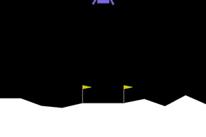
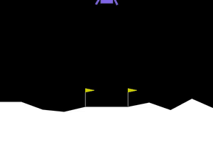
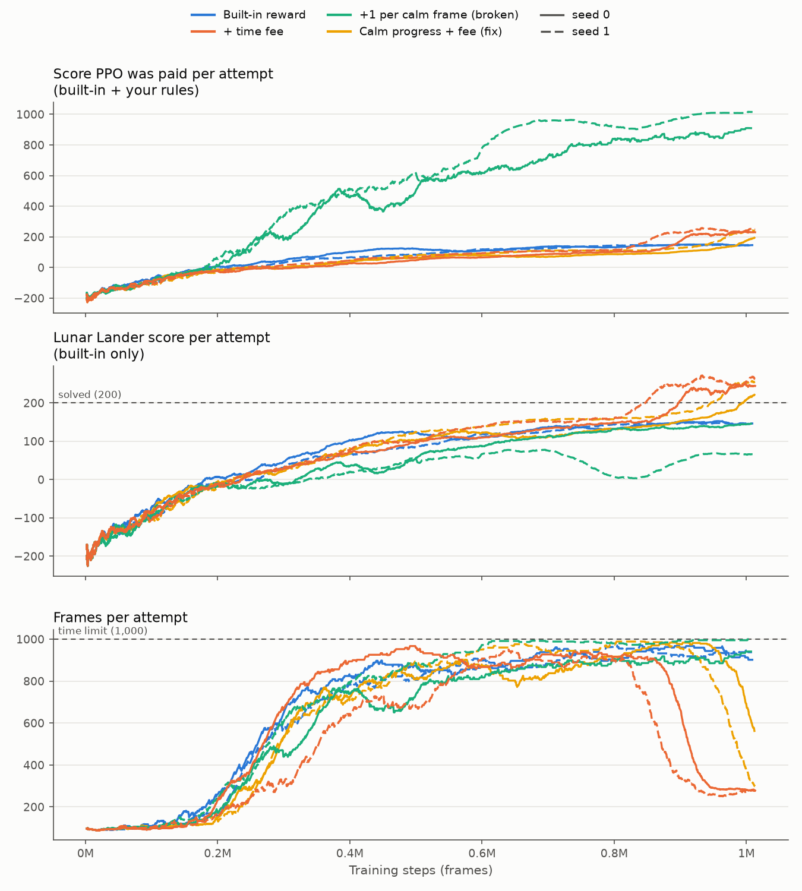

# Lunar Lander: teaching a rocket to land, then catching it cheating

I trained a small neural network with reinforcement learning to land the rocket in
[Gymnasium's Lunar Lander](https://gymnasium.farama.org/environments/box2d/lunar_lander/),
then wrote my own reward rules on top. One rule broke it on purpose (the rocket learned to
hover forever instead of landing), and another fixed it.

Everything runs on a laptop CPU, with no GPU.

| Random actions | Trained (built-in reward) | My broken reward: hovers | My fixed reward: lands |
|:---:|:---:|:---:|:---:|
|  |  |  |  |
| crashes after 91 frames | lands, score 237 | still hovering at the 1,000-frame limit | lands, score 240 |

Full-size MP4s (three attempts each) are in [`videos/`](videos).

## How it works

Each frame (50 per second), the game hands the AI eight numbers: position relative to the pad,
speed, tilt, spin, and whether each leg is touching the ground. The AI picks one of four actions:
do nothing, fire the left engine, fire the main engine, or fire the right engine.

The AI is a small neural network (two layers of 64 units, Stable-Baselines3's `MlpPolicy`)
trained with **PPO** ([Proximal Policy Optimization](https://arxiv.org/abs/1707.06347)). It flies,
gets a reward every frame, and nudges its weights toward the choices that earned more. The
built-in reward pays for getting closer to the pad, slower, and more level, charges for fuel,
and ends with +100 for coming to rest or -100 for a crash.

The AI learns exactly what you score. **Reward shaping** means changing the score to steer the
behavior. **Reward hacking** is what happens when the score you wrote pays for something you didn't
mean.

## Results

Every model below was tested on the **plain game, with my reward wrapper turned off**, over 50
attempts on start positions it never trained on. An average of 200 or more counts as solved.

| Reward used in training | Seed | Avg score (50 attempts) | Landed | Timed out | Avg frames |
|---|:---:|---:|:---:|:---:|---:|
| Built-in | 0 | **261.9** ± 23.8 | 49 | 1 | 324 |
| Built-in | 1 | **264.1** ± 18.4 | 50 | 0 | 336 |
| Built-in + time fee | 0 | **265.8** ± 18.9 | 50 | 0 | 309 |
| Built-in + time fee | 1 | **267.4** ± 18.6 | 50 | 0 | 297 |
| Built-in + 1 per calm frame (**broken**) | 0 | 186.8 ± 54.8 | 35 | 15 | 668 |
| Built-in + 1 per calm frame (**broken**) | 1 | -49.3 ± 32.2 | 0 | **50** | 1000 |
| Built-in + calm progress + time fee (**fix**) | 0 | **259.0** ± 27.2 | 49 | 1 | 341 |
| Built-in + calm progress + time fee (**fix**) | 1 | **271.5** ± 18.8 | 50 | 0 | 269 |

No model crashed in any of the 400 test attempts. Each run trained for 1,000,000 frames, which
took about 11 minutes per run on CPU with up to eight runs going at once.



*Each point is the average over the last 100 attempts during training. Solid lines are seed 0,
dashed lines are seed 1.*

## The reward experiments

All rules live in [`rewards.py`](rewards.py) as Gymnasium wrappers. A wrapper is a thin layer
between the game and PPO: it takes the built-in reward, adds its own terms, and passes the total
on, without touching the game's code.

"Calm" means upright and slow: tilt under 0.2 radians and speed under 0.2 (in observation units).

### 1. Time fee (step 5): -0.05 per frame

The built-in reward has no cost for time, only for fuel. A small fee per frame still lands
(265.8 and 267.4) and lands a bit faster.

The training curves show a bigger effect. During training, PPO acts with some randomness to
explore. With the built-in reward, that exploring rocket learned to touch down and then sit on
the pad blipping its engines. The blips stop it from ever coming to rest, so it never collects the
+100. Its attempts ran about 900 frames, with a score stuck near 145. I checked this directly:
in 18 of 20 exploring attempts, it timed out with both legs on the pad. With the time fee,
sitting there costs something, so the same exploring rocket learned to settle and finish
(18 of 20 landed, 275 frames on average). That is the blue-vs-orange split at around 0.85M
frames in the bottom panel.

### 2. The broken rule (step 6): +1 for every calm frame

```python
if is_calm(obs):
    reward += 1.0
```

An attempt is cut off at 1,000 frames. A rocket that just hangs in the air can collect up to
1,000 points from this rule, and fuel costs it at most 300. Landing ends the attempt and stops the
payments. So hovering beats landing, and PPO found that out:

- **The score went up while the rocket got worse.** The score PPO was paid climbed to about
  1,000 (top panel), while the real Lunar Lander score stayed below 150 (middle panel).
- **Seed 1 never lands.** All 50 test attempts run out the clock, and its real score is -49.
  In the 20 attempts I checked closely, it was still in the air at the time limit in 19, at a
  median height of 0.60 (it starts at 1.4), and it was calm in 95% of frames.
- **Seed 0 only partly cheats.** It hovers out the clock in 15 of 50 attempts. This is why you
  train more than once: one run alone would have made the bug look half as bad as it is.

### 3. The fix (step 6): pay for getting calm, not for staying calm

```python
reward += 1.0 * (float(calm_now) - float(calm_before))   # +1 on becoming calm, -1 on losing it
reward -= 0.05                                           # time fee: waiting costs something
```

This pays for the change between frames, the same way the built-in score does, instead of for
sitting in a nice state. Over a whole attempt, these payments add up to at most +1, so there is
nothing left to farm by hovering. The time fee means stalling now costs points. Both seeds land
again (259.0 and 271.5), and seed 1 has the fastest landings of all eight models (269 frames on
average).

This is the idea behind *potential-based reward shaping*: reward the difference in a score
between frames, never the score itself.

## Run it yourself

Requires Python 3.10 or newer. Tested on Windows 11 with Python 3.13.

```bash
python -m venv .venv
.venv\Scripts\activate          # macOS/Linux: source .venv/bin/activate
pip install -r requirements.txt
```

| Step | Command | What it does |
|---|---|---|
| Watch it fail | `python random_agent.py` | Opens the game window, flies random actions, prints the 8 numbers |
| Train | `python train.py` | PPO on the built-in reward, 1M frames, saves `models/builtin_seed0.zip` |
| Record | `python record.py --model models/builtin_seed0.zip --name landing` | MP4s with `RecordVideo` and a GIF, in `videos/` |
| Your reward | `python train.py --reward time_fee` | Retrain with the time fee |
| Break it | `python train.py --reward hover_bonus --seed 1` | Retrain with +1 per calm frame |
| Fix it | `python train.py --reward calm_progress --seed 1` | Retrain with calm progress + time fee |
| Score it | `python evaluate.py models/*.zip` | 50 attempts each on the plain game, wrapper off |
| Plot it | `python plot.py` | `results/training_curves.png` from the training logs |

During training, `ep_rew_mean` is the score PPO is paid (built-in plus your rules), and
`builtin_score_mean` is the plain Lunar Lander score for the same attempts. Watch both: if
the first climbs and the second doesn't, your reward is being hacked.

PPO settings come from the Hugging Face Deep RL Course, Unit 1: 16 environments in parallel,
`n_steps=1024`, `batch_size=64`, `n_epochs=4`, `gamma=0.999`, `gae_lambda=0.98`,
`ent_coef=0.01`.

## Project layout

```
rewards.py        reward wrappers: TimeFee, HoverBonus (broken), CalmProgress (fix)
random_agent.py   step 2: random actions with the game window on
train.py          steps 3, 5, 6: PPO training, --reward picks the experiment
record.py         step 4: RecordVideo MP4s + README GIF
evaluate.py       average score over 50 attempts, wrapper off
plot.py           training curves from the Monitor logs
models/           the 8 trained models (Stable-Baselines3 .zip)
logs/             per-run console output and Monitor CSVs (one per parallel game)
results/          evaluation and timing JSON per run, training_curves.png
videos/           MP4 clips and GIFs
```

## Notes

- **Use `LunarLander-v3`.** Older tutorials, including the Hugging Face course, say `v2`, which
  no longer exists in current Gymnasium.
- **The Box2D install just worked.** Gymnasium 1.4's `box2d` extra now installs a prebuilt
  Box2D wheel, so swig and a C++ compiler weren't needed on Windows. On older versions, if the
  install fails with an error mentioning `swig`, run `pip install swig` and try again.
- **Exploring and testing behave differently.** Training curves show the exploring policy
  (random sampling), while evaluation uses the deterministic one (always the most likely action).
  That is why the built-in runs plateau near 145 in training but score 262 in testing.

## References

- [Stable-Baselines3: Installation](https://stable-baselines3.readthedocs.io/en/master/guide/install.html)
- [Gymnasium: Basic Usage](https://gymnasium.farama.org/introduction/basic_usage/)
- [Gymnasium: Lunar Lander](https://gymnasium.farama.org/environments/box2d/lunar_lander/)
- [Hugging Face Deep RL Course, Unit 1](https://huggingface.co/learn/deep-rl-course/unit1/introduction)
- [Stable-Baselines3: Examples](https://stable-baselines3.readthedocs.io/en/master/guide/examples.html)
- [Gymnasium: Implementing Custom Wrappers](https://gymnasium.farama.org/tutorials/gymnasium_basics/implementing_custom_wrappers/)
- Schulman et al., [Proximal Policy Optimization Algorithms](https://arxiv.org/abs/1707.06347), 2017
